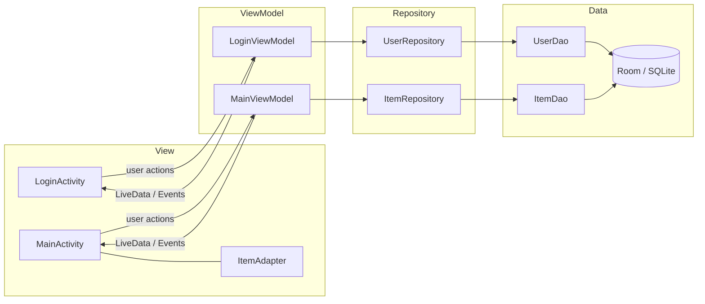
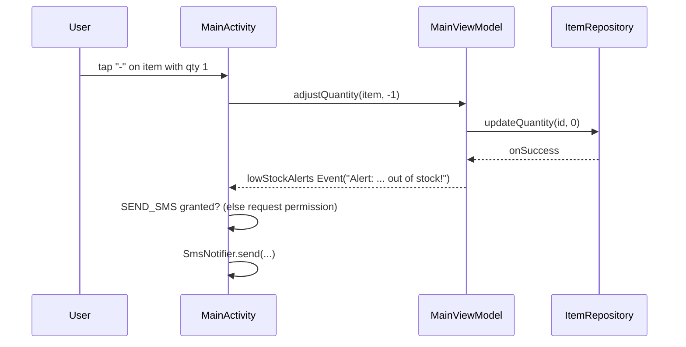

# Architecture

## Rules the design enforces

1. **Views never touch the database.** `MainActivity` and `LoginActivity` only observe LiveData and call ViewModel methods.
2. **ViewModels never touch Android framework classes.** They take a repository interface, so tests inject a fake.
3. **Repositories own threading.** Room work runs on a single-thread executor; ViewModels use `postValue` from callbacks.
4. **One-shot UI effects use `Event<T>`.** Toasts and the SMS request are consumed once, so rotation doesn't replay them.
5. **Platform work stays in the View layer.** The ViewModel only *requests* a low-stock alert; `MainActivity` handles the permission prompt and `SmsNotifier` sends the message.

## Low-stock alert flow

